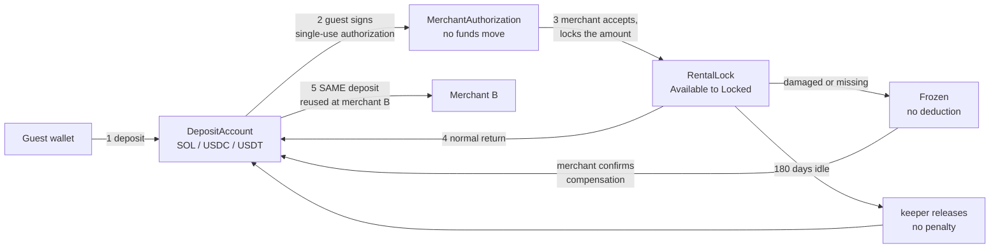
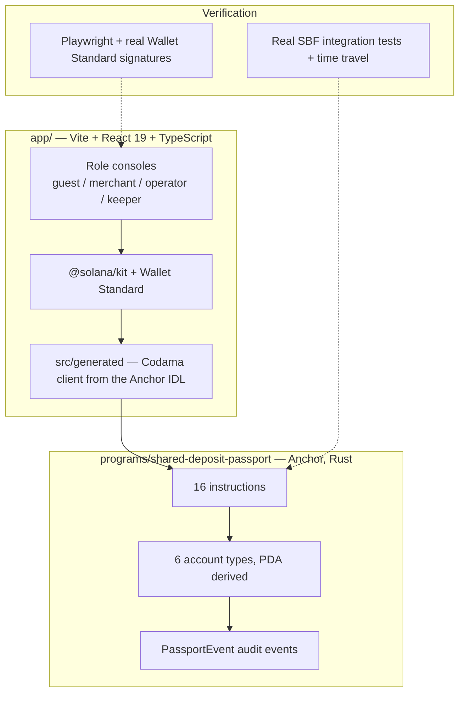
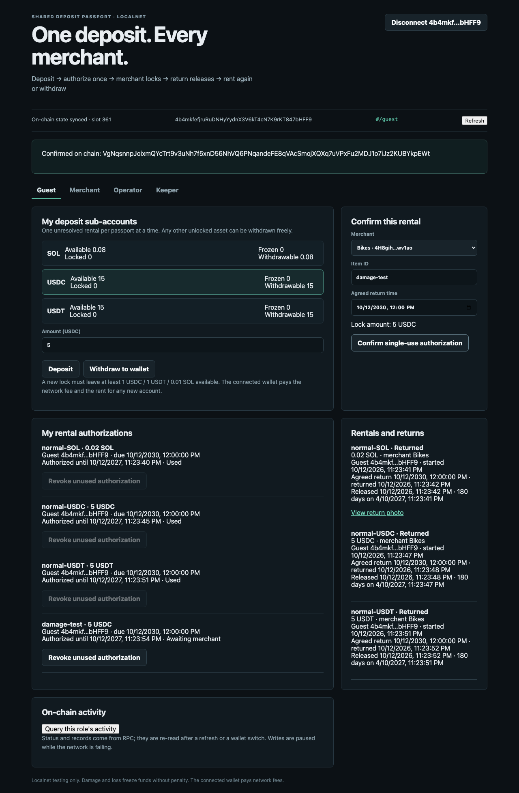
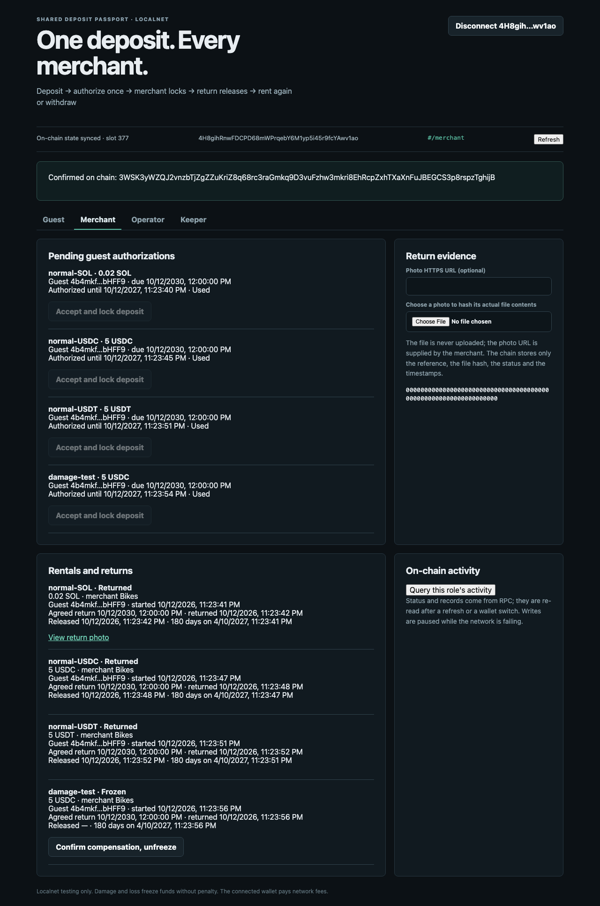
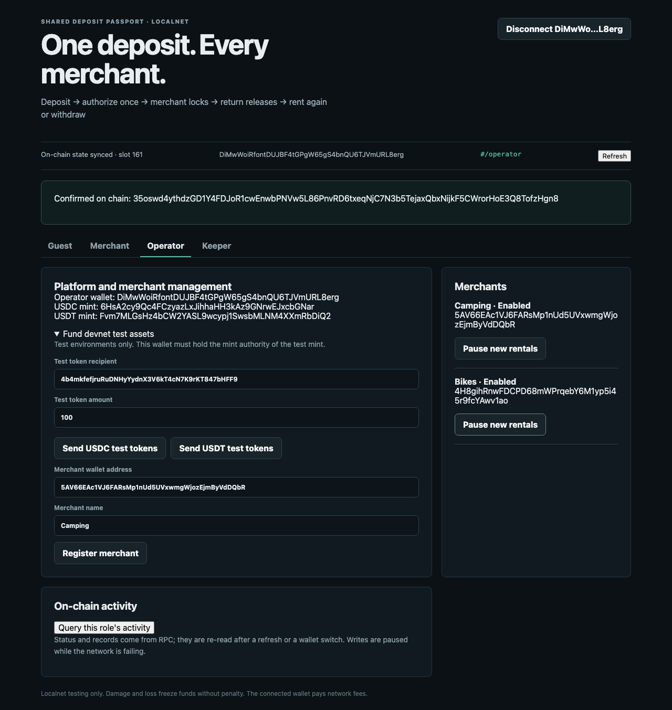
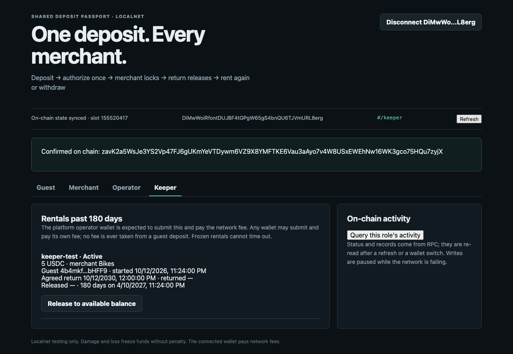

# Shared Deposit Passport

**Pay a deposit once. Rent from every merchant.**

A single on-chain deposit passport: a guest deposits once, then any allowlisted
merchant can lock an amount the guest explicitly authorized for that specific
rental. On return the funds are released back to the passport and are immediately
reusable at the next merchant — no re-depositing, no refund wait.

> Built for **Colosseum**. Solana devnet only. No real funds.

| | |
| --- | --- |
| **Live demo (devnet)** | https://shared-passport.vercel.app — connect a wallet switched to devnet |
| **Demo video (3 min)** | https://YOUR-VIDEO-URL |
| **Program** | `Bw5pP788g5eK117b7oA1dzSMg4N5ZG5vjcHpEKTzzN2o` |
| **Network** | Solana devnet |
| **License** | MIT |

## The problem

A traveller renting from four vendors in one day pays four deposits. Each one is a
separate payment, a separate refund request and a separate wait. Merchants pay the
same cost from the other side: manual refunds, disputes, and staff time spent
administering deposits instead of renting.

The deposit is a trust primitive. Today every merchant re-implements it badly, and
the customer pays for the duplication with their cash flow.

## What it does



The guest's funds never leave the program until the guest withdraws them. The
merchant never custodies the deposit: it can only lock an amount the guest
authorized, under the rules the program enforces.

## Architecture



There is **no backend, no database, no indexer and no demo mode**. Every balance,
authorization, rental and audit row is read from the chain. Refresh re-reads
persisted state from RPC.

## Try it in 30 seconds

### With no wallet at all

- Open the live link. The header band prints the slot it just read from devnet.
- Open the **Operator** console. It lists the platform operator, both test mints and both
  registered merchants — as full addresses, every one of which opens in an explorer.

### With any devnet wallet — yours, empty, unrelated

- Still in the **Operator** console, click **Query this role's activity**. The history is
  read from the *platform* account rather than from your wallet, so it shows what actually
  happened on devnet: the platform initialized, two merchants registered, and a guest's
  passport, asset account and deposit — those last three in a single transaction. Every
  row carries the signature it came from.
- If you hold a little devnet SOL, deposit and withdraw it. That path is yours alone and
  needs nobody's permission, which is what an account the guest owns is for.

The rest of the loop needs a second party: a lock is accepted by a *merchant* key, and the
recorded demo's two merchants are wallets held by the developer. That is the part the video
shows — and the activity above is how you confirm a rental happened without having to trust
the video. Step by step: [DEMO-SCRIPT.md](DEMO-SCRIPT.md).

## Roles

| Console | URL | Can do |
| --- | --- | --- |
| **Guest** | `#/guest` | Deposit SOL/USDC/USDT, authorize one rental, revoke an unused authorization, withdraw unlocked funds |
| **Merchant** | `#/merchant` | Accept and lock a guest-authorized amount, submit return evidence, freeze on damage/missing, unfreeze after compensation |
| **Operator** | `#/operator` | Initialize the platform, allowlist merchants, pause/resume a merchant |
| **Keeper** | `#/keeper` | Release a rental that stayed active and untouched for 180 days. Never touches deposits |

Four consoles, one program state machine, one wallet identity. They are separated
by URL rather than by repository because the real authorization boundary is the
program, not the page: nothing a console could do in its own bundle would change
what the chain accepts. The wallet chooses the landing console — the platform
authority lands on operations, a registered merchant on the merchant console,
everyone else on the guest console — and any console you open by hand is
remembered across reloads.

Routing is hash-based on purpose: the fragment never reaches the server, so one
static build serves every deep link with no rewrite rules and no way to 404 one.

## Consoles









These are saved by the end-to-end run (`app/e2e/product.spec.ts`) at the point in
the flow where each console is populated. They therefore show state produced by
real signed transactions against the compiled program on a local validator, not a
staged mock, and they cannot silently drift from the UI. The header band in each
one shows the console it came from.

## Why this is not a mock

Most hackathon contracts are only exercised through a happy-path script. This one
is verified against the **actual compiled SBF program**:

| Verification | What it proves |
| --- | --- |
| Real SBF integration tests | 16 instructions, 6 account types, three assets (SOL/USDC/USDT) end to end |
| Negative-path suite | Foreign mints, wrong signers, revoked/expired authorizations, nonce replay, bound-account substitution, concurrent locks, duplicate transitions, premature keeper calls |
| Time travel | The 180-day keeper rule, without bypassing the timer |
| Frozen-state rule | Frozen rentals do **not** auto-release at 180 days; only the original merchant can unfreeze after compensation |
| Wallet-signed browser E2E | Full four-role flow with real Wallet Standard signatures, not mocked state |
| Deliberate RPC failure | The response is dropped *after* the validator executed. The UI blocks new writes, survives a reload, and resolves the saved signature. The balance increases exactly once |
| Deployed-build smoke test | The **live URL** in a real browser: zero page errors, console errors, failed requests and 4xx responses, a live slot read, and the platform's real audit trail read back with a wallet that holds none of the demo's keys |
| Genesis check | Funds operations are blocked unless the RPC is genuinely devnet |

Reproduce it yourself. No keys, no funded wallet and no network needed: the
suite starts its own validator and deploys the compiled program.

```bash
cd app
npm install && npx playwright install chromium
npm test           # 32 unit tests over the client's decoding and validation, ~6s
npm run test:e2e   # 3 browser tests driving all four consoles, ~45s

# The deployed build, against the URL above rather than a local validator:
DEMO_URL=https://shared-passport.vercel.app npm run test:e2e
```

The e2e run also regenerates the console screenshots above.

Test commands and current results: [VERIFICATION.md](VERIFICATION.md).
Acceptance scenarios: [tests/acceptance.md](tests/acceptance.md).
Failure surface: [tests/edge-cases.md](tests/edge-cases.md).

## Scope

**In v1:** three assets, one global lock per passport, single-use authorizations,
merchant return states, freeze/unfreeze, 180-day keeper release, unsigned
withdrawal to the guest wallet, full audit trail.

**Deliberately out:** mainnet, real funds, fiat on-ramp, custody, interest,
automated deductions, damage arbitration, insurance, multi-chain. Each is a scope
decision, not an unfinished item.

**Not yet operated:** the 180-day keeper and the dispute path are implemented and
tested, but no real party runs them yet.

---

# Developer guide

## Project layout

- `programs/shared-deposit-passport/`: Anchor program and account/state machine.
- `app/`: Vite + React client using Solana Kit and Wallet Standard.
- `tests/acceptance.md`: Given/When/Then acceptance scenarios.
- `RESEARCH.md`, `PRD.md`, `PLAN.md`: product and implementation sources of truth.

## Client

```bash
cd app
npm install
npm run dev
```

Set `VITE_SOLANA_RPC_URL` to use a custom devnet RPC. The client never targets mainnet.

## Program

The Anchor workspace requires Rust, Solana CLI, Anchor CLI and a devnet wallet. Once installed:

```bash
bash scripts/build.sh
```

Never commit wallet keypairs, seed phrases, or devnet secrets.

The build script explicitly uses SBF platform-tools v1.57 (Rust/Cargo 1.95).
The Solana CLI's default v1.48 tools cannot parse the current dependencies'
edition 2024 manifests. The script builds the program and Anchor IDL locally;
it does not deploy or send transactions.

## Generate, verify and run

```bash
bash scripts/build.sh
cd app
npm install
npm run generate
npm run build
npm test
npx playwright install chromium
npm run test:e2e
npm run dev -- --host 127.0.0.1
```

Against a live deployment, one read-only command reports what the browser setup has
completed and what is left, reading it from the chain rather than from memory. It
sends no transaction and reads no private key:

```bash
node scripts/demo-status.mjs                                    # program, platform, merchants
node scripts/demo-status.mjs guest=<ADDR> bikes=<ADDR> camping=<ADDR>   # plus SOL and token balances
```

Integration tests use the real compiled SBF program, actual synthetic signatures,
SPL transfers and time travel in offline Surfpool. Browser tests launch their own
local RPC and Vite server, register synthetic Wallet Standard wallets and exercise
actual UI transactions. These test wallets are never included in the product.

The page has guest, merchant, operator and keeper consoles. Balances, pending
authorizations, rentals and audit events are read directly from the chain; there
is no demo mode, backend, database or account indexer. Refresh retrieves persisted
state. Every write is simulated and reviewed before wallet signing. When a result
is uncertain, query or resend the saved transaction instead of creating another.

## Devnet setup and walkthrough

Program: `Bw5pP788g5eK117b7oA1dzSMg4N5ZG5vjcHpEKTzzN2o`.

1. Fund the deployment authority wallet with devnet SOL. Check exact rent using
   `node scripts/deployment-check.mjs <PUBLIC_WALLET_ADDRESS>`.
2. Review and execute `NO_DNA=1 solana program deploy --url devnet target/deploy/shared_deposit_passport.so`.
   The CLI must use the intended deployment wallet; never copy its keypair into this project.
3. The **Operator** console can create two different six-decimal classic SPL test mints
   using wallet signing. Existing approved devnet test mints also work. These
   are project test assets, not redeemable USDC/USDT.
4. Set the public devnet RPC in `app/.env` if necessary; default is devnet.
   `VITE_LOCALNET=true` is accepted only on a loopback RPC URL. The program address
   comes from the generated client; mint addresses come from the platform account.
5. In the browser connect the deployment authority wallet. Under **Operator**, initialize
   the platform with the two mint addresses and register two merchant public keys.
   Open `Fund devnet test assets` to mint test tokens to the guest wallet; the current
   wallet must be the mint authority. The operator pays the receiving ATA rent.
6. Connect the guest wallet. Deposit SOL/USDC/USDT, choose an enabled merchant,
   item, amount and due time, then confirm the single-use authorization.
7. Connect that merchant wallet. Accept the guest authorization and lock funds.
   Confirm normal return to release funds into the program balance. Alternatively,
   record damage/missing and later confirm compensation to unfreeze without deduction.
8. Switch back to the guest. Reuse the deposit at the second merchant or withdraw
   to the guest wallet. An unlocked asset may withdraw while another is locked.
9. Any connected wallet can release ACTIVE rentals after 180 days from locking.
   FROZEN rentals cannot time out. The invoking wallet pays fees; no keeper fee
   comes from deposits. Local tests time-travel; devnet never bypasses the timer.

Selecting a photo computes SHA-256 from file content. The merchant supplies an
external HTTPS photo link; originals are not uploaded or stored by this app.
Account rent remains in program state accounts; withdrawal moves deposit funds,
not account rent. Historical state accounts are retained for auditability.

Devnet acceptance is separate from local test success. A funded deployment wallet,
two test mints, and real connected browser wallets are required to finish it.

## Documents

- [PITCH.md](PITCH.md) — problem, model, market, roadmap
- [VERIFICATION.md](VERIFICATION.md) — what is verified, with evidence
- [DEPLOYMENT.md](DEPLOYMENT.md) — devnet deployment details
- [RUNBOOK-DEPLOY.md](RUNBOOK-DEPLOY.md) — step-by-step deploy and initialize runbook
- [DEMO-SCRIPT.md](DEMO-SCRIPT.md) — three-minute demo shot list
- [tests/acceptance.md](tests/acceptance.md), [tests/edge-cases.md](tests/edge-cases.md)
- [PRD.md](PRD.md), [RESEARCH.md](RESEARCH.md), [PLAN.md](PLAN.md)
